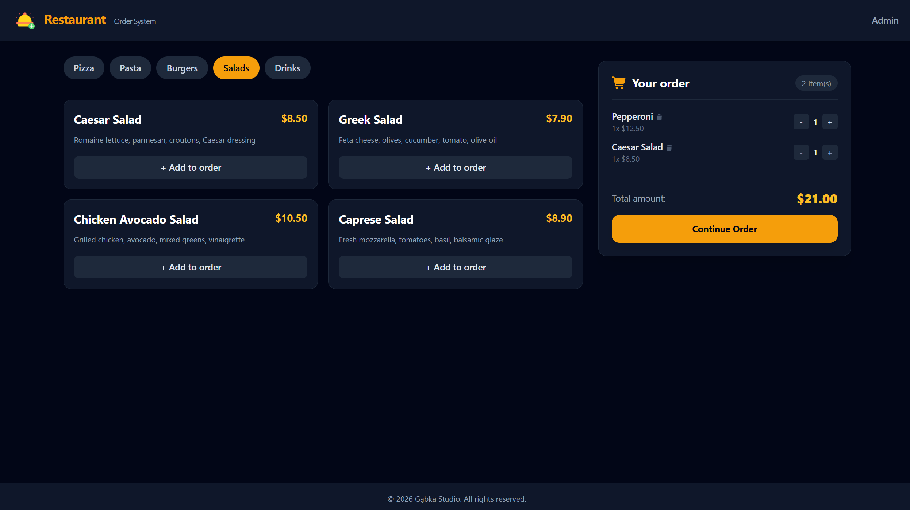

# 🍽️ Restaurant Admin Panel

A modern, high-performance web application for managing restaurant orders, menu categories, and products in real time. Built with **Angular 19** utilizing cutting-edge features like **Signals**, **Standalone Components**, and **OnPush Change Detection Strategy**.

---

## 🚀 Live Demo

* **Frontend:** [https://rorder.gabkastudio.pl/](https://rorder.gabkastudio.pl/)
* **API Backend:** [https://api-ro.gabkastudio.pl/](https://api-ro.gabkastudio.pl/)

---

## 📸 Overview & Features

### Key Features:
* **Real-time Order Management:** Dynamic sorting and filtering of customer orders using reactive computed signals.
* **Product & Category Management:** Interactive drag-and-drop / selection interfaces for managing restaurant offerings.
* **Optimized UI/UX:** Clean, responsive user interface styled with **Tailwind CSS** featuring custom dynamic status tinting.
* **Standalone Architecture:** Modern Angular structure without `NgModule` overhead, ensuring clean dependency injection and fast load times.
* **OnPush Performance:** Optimized change detection strategy across components to minimize unnecessary re-renders.

---

## 🛠️ Tech Stack

* **Frontend Framework:** Angular 19 (Signals, Standalone Components, `computed`, `signal`, RxJS, HttpClient)
* **Styling:** Tailwind CSS
* **Backend:** Node.js + `json-server` (v0.17.4) running as a dedicated sub-application
* **Hosting & Server Setup:** Apache (SPA routing via `.htaccess`) + Node.js environment